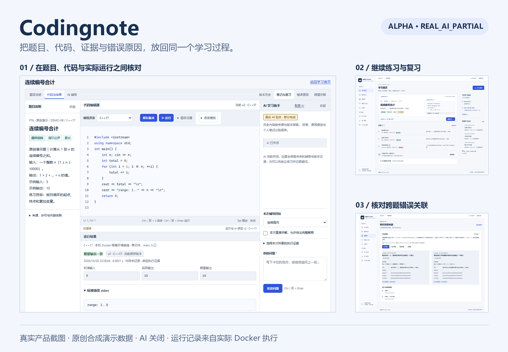
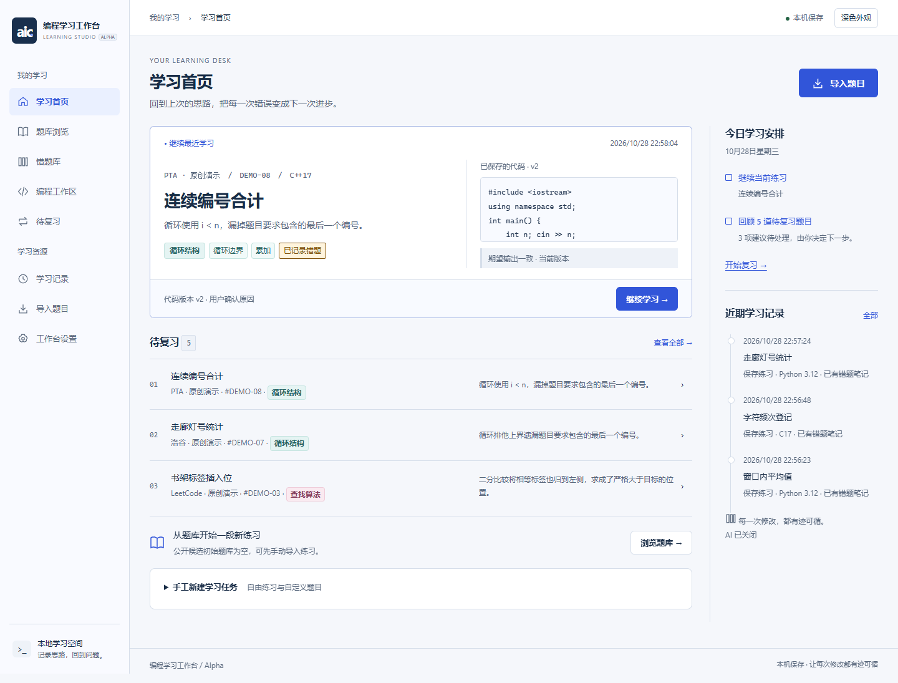
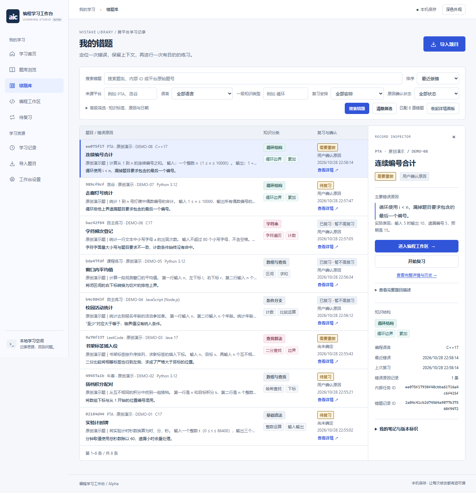
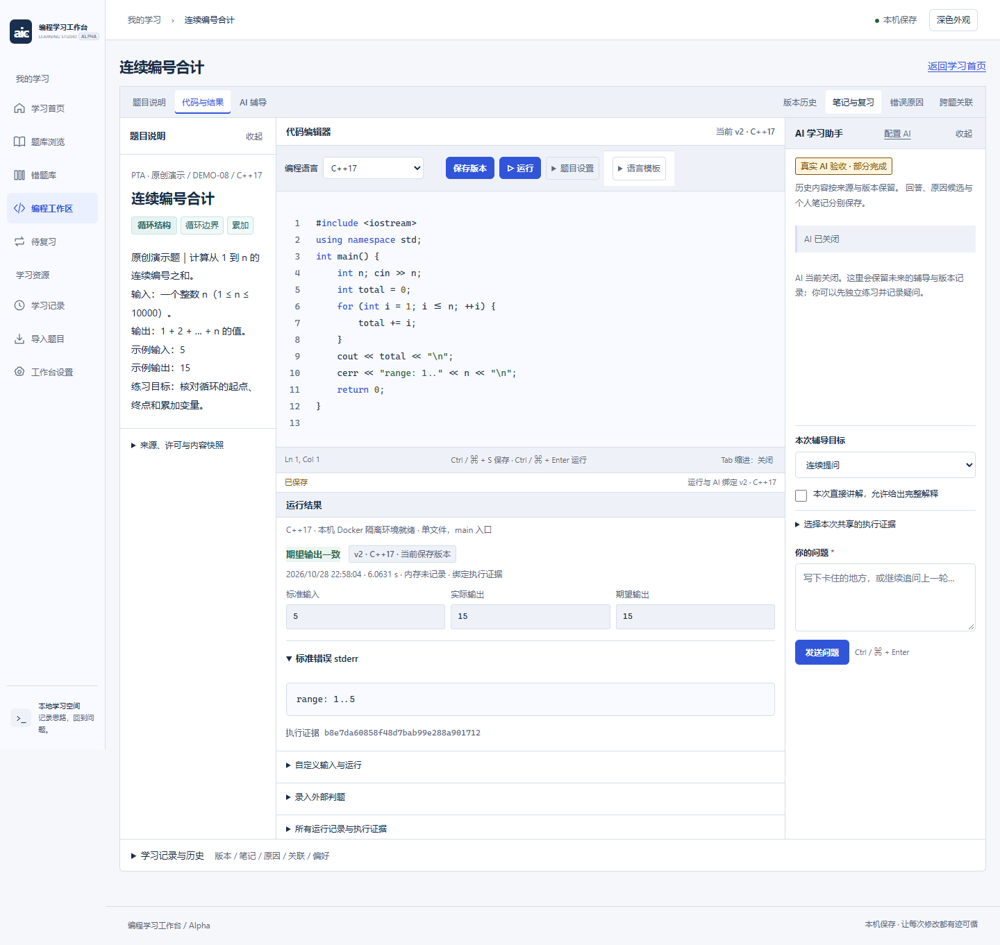
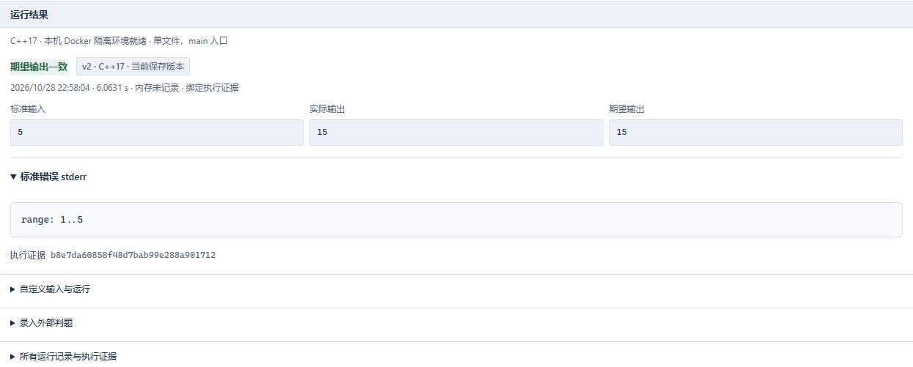
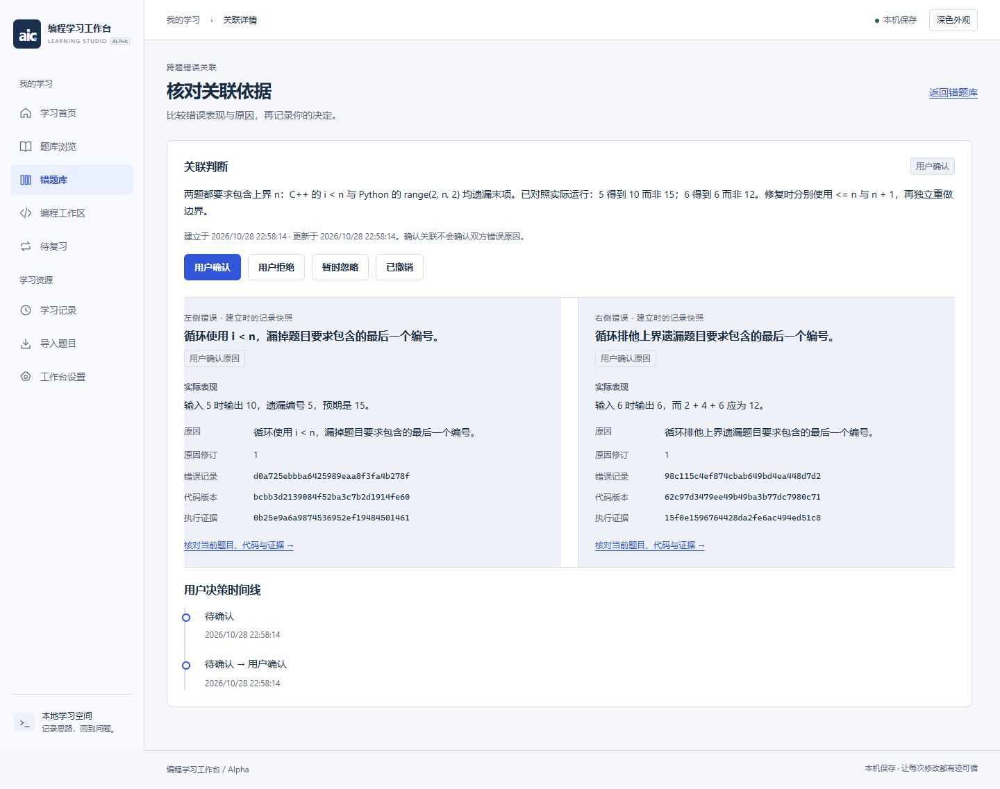
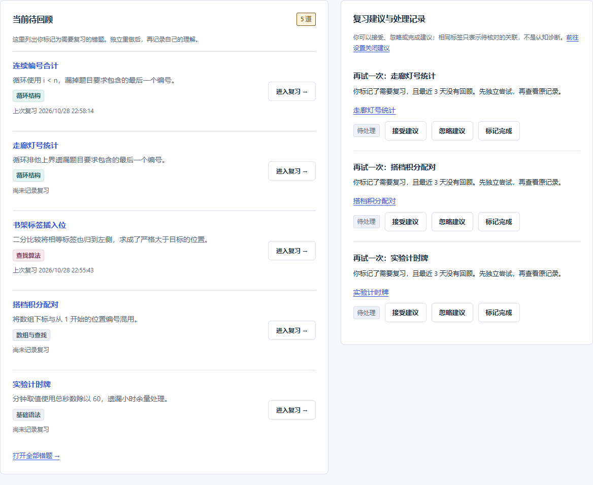
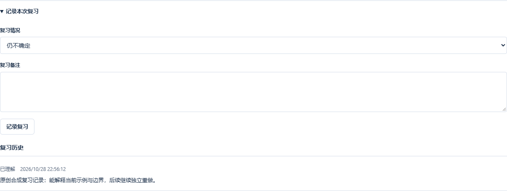

<div align="center">

# AIC 编程错题学习工作台 · Codingnote

**不只记下哪道题做错了，也记下为什么错、怎样改，以及下一次该回看什么。**

`Alpha` · `REAL_AI_PARTIAL` · `MIT` · `Python 3.12` · `本地 Web 工作台`

[快速开始](#-快速开始) · [产品场景](#-把分散的记录连成学习过程) · [AI 与费用](#-可选-ai-辅导) · [完整文档](#-文档与开发)

</div>



Codingnote 面向大学生与编程自学者，将不同来源的题目、代码版本、运行结果、错误原因和复习记录放进同一个本地工作台。它帮助你回到出错时的具体代码和证据，核对原因，再独立重做。

> **展示说明**：下方均为当前公开 Alpha 的真实浏览器截图，使用独立临时目录中的 **8 道原创合成题与演示学习记录**。运行结果来自这些代码的实际 Docker 执行；AI 保持关闭，没有真实 API 调用或虚构教学效果。它们不会预装到用户题库。详见 [图片与数据索引](docs/assets/showcase/README.md)。

## ✨ 为什么做这个项目

在 PTA 做完一道题，在洛谷补一道练习，再回到课程作业，同一种循环边界错误可能出现好几次。题目和提交分散在不同地方，留下的往往是“这次错了”，而当时的思路、改动和出错原因却很快被忘记。

Codingnote 希望保存更完整的学习上下文：

| 回顾时想知道什么 | 工作台保留什么 |
|---|---|
| 当时写了什么，后来改了哪里？ | 原始代码、修改后的版本与保存历史 |
| 这个判断有什么依据？ | 绑定具体代码版本的运行记录，以及原因的确认状态 |
| 其他题为什么也出过类似问题？ | 两条错误记录的关联依据、双方快照与用户决策 |
| 下一次怎样避免重复犯错？ | 错题笔记、待复习标记、重做结果和本地规则建议 |

这里的“跨平台”指 **不同来源题目的统一管理**。链接识别只提供平台与题号候选，不自动抓取题面、不登录平台、不同步提交记录，也不替代原平台判题。

## 🧩 把分散的记录连成学习过程

### 先把题目和学习安排放到一起

首页可继续最近练习、查看待复习题目与近期记录；错题库按来源、语言、知识类型、标签和状态整理内容。手动导入的题目由用户核实使用权，初始内置题库为 **0 道**。



*示例首页串起最近保存的练习与复习安排，学习数据保存在本机。*



*演示来源标签用于展示归类，不表示这些原创题来自对应平台的真实题库。*

### 在同一个工作区保存代码与证据

题目说明、代码编辑、运行结果与可选 AI 辅导入口放在同一工作区。先保存代码再运行，每份结果绑定当时的代码版本；后续修改不会把旧结果变成新代码的证明。



*当前展示修复后的连续编号合计；右侧保留 AI 关闭和真实 AI 部分验收状态。*



*输入 5 得到 15；stderr 中的范围诊断由演示代码实际输出。单个输入一致不代表整道题已通过评测。*

### 让错误原因可以核对，让相似错误可以关联

错误原因可绑定出错版本和执行证据，区分待核对、用户确认与修订。跨题关联从两条错误记录出发，比较建立时的快照，再由用户确认、拒绝、忽略或撤销；标签相同不等于原因相同。



*一个遗漏最后一个编号，一个遗漏偶数上界。关联依据来自两份错误记录与实际输出，由用户核对。*

### 回到题目，独立重做

错题笔记可以指定原始与修复版本、保存总结并标记待复习。重做后记录“已理解 / 仍不确定 / 需要重做”，保留复习历史；学习建议来自本地规则，最终由用户决定。



*复习队列是下一次练习的入口，不是教学效果评分或系统定时推送。*



*这是合成学习历史中的一条用户自评，不构成已验证的学习效果。图片可点击查看原始分辨率。*

## 🔄 核心学习流程

**收集题目 → 保存代码版本 → 运行并保留证据 → 记录错误原因 → 核对跨题关联 → 回顾与重做**

可以始终关闭 AI，完成上述本地记录、执行与复习流程。错误原因记录与错题笔记分别保存，保存原因不会自动完成错题整理。

| 功能 | 当前可用范围 |
|---|---|
| 题目导入 | 手动录入、链接来源候选；截图提供预览和可选本地 OCR 草稿，OCR 真实识别尚未验收 |
| 分类与筛选 | 来源平台、原题号、一级知识类型、二级标签、语言及复习状态 |
| 版本与运行 | 保留代码历史；运行记录绑定版本与源码摘要，代码执行需要本机 Docker 环境验收 |
| 错误追踪 | 原因、实际表现、证据绑定、确认状态与原因修订历史 |
| 跨题关联 | 基于两条错误记录提出关联，核对快照并保存决策，依据变化可能使关联失效 |
| 复习管理 | 错题笔记、待复习、重做自评、复习历史及本地规则建议 |
| 备份恢复 | 停止服务后 CLI 备份完整学习 SQLite 并恢复到新目录；网页脱敏导出不能替代完整恢复备份 |

## 💻 技术栈与支持边界

浏览器中的 HTML/CSS/JavaScript 页面通过 **FastAPI** 访问本地 **Python** 服务，学习记录写入 **SQLite**；代码运行由后端交给受约束的 **Docker** 容器。无需 npm 构建前端。

| 语言 | 当前执行方式 |
|---|---|
| Python 3.12 | 单文件，语法检查后隔离运行，不包含用户第三方包安装 |
| C17 / C++17 | 单文件，GCC/G++ 编译后运行 |
| Java 17 | 单源文件、无 package、标准 main 入口；类名等限制见详细文档 |
| JavaScript | Node.js 单文件 CommonJS，可用内置模块，不安装 npm 依赖 |

当前有安装验收依据的系统是 **Windows + 64 位 Python 3.12**。macOS/Linux、其他浏览器与移动硬件没有完整验收。应用按可信本机单人使用设计，只绑定回环地址，不支持公网多人判题服务；GitHub Pages 无法运行这个 Python 服务。

没有 Docker 也能录题、保存版本、管理错题和复习。执行环境未就绪时会拒绝运行，不回退到宿主机执行。详见 [功能与限制](docs/FEATURES_AND_LIMITATIONS.md)。

## 🚀 快速开始

克隆仓库，或下载源码 ZIP 后解压，在包含 `alpha/` 和 `requirements-lock.txt` 的目录打开 PowerShell：

```powershell
git clone https://github.com/Departure0619/Codingnote.git
cd Codingnote
python -m venv .venv
.\.venv\Scripts\python.exe -m pip install -r requirements-lock.txt
.\.venv\Scripts\python.exe -X utf8 -m question_bank.validate
.\.venv\Scripts\python.exe -X utf8 -m alpha --port 8039 --data-dir data/public-demo --runtime-dir data/public-runtime --no-browser
```

打开 [本机工作台](http://127.0.0.1:8039/)，点击“导入题目”，填写自己编写或有权使用的内容并保存进入工作区。先保存代码版本，再运行、记录原因与错题笔记；在前台终端按 `Ctrl+C` 停止服务。

运行代码前，需要在自己的机器完成 Docker 构建与五语言验收，不复制其他环境的验收收据。[完整安装指南](docs/QUICK_START.md) 说明了 Docker 设置、第一道题、停止服务、备份恢复与常见问题。

## 🤖 可选 AI 辅导

当前实现对接 **DeepSeek 官方 API**。AI 默认关闭，重启后需要使用者重新填写自己的 Key，主动授权数据发送、批准请求次数及费用；保存配置不会自动测试连接。

- **真实调用可能收费。** 本地费用是估算，不是服务商余额或实际扣费硬上限。
- **模拟模式只是流程演示。** 固定对话不能证明真实模型分析、诊断或总结已通过验收。
- **状态仍为 `REAL_AI_PARTIAL`。** 完整真实教学闭环、真实总结编辑保存及部分 C++ 解释/总结尚未完整验收。
- **当前预算机制仍有限制。** 真实传输保留历史累计 8 次 / US$0.50 范围与受控复验门禁，不是可任意设额的通用个人 AI 产品；不能承诺填 Key 即可全面使用。

请先阅读 [DeepSeek 官方 API 配置与费用说明](docs/DEEPSEEK_API_SETUP.md)。安装、看图或体验本地管理功能都不需要发起真实模型请求。

## 🔒 隐私与数据管理

学习记录保存在指定目录的普通 SQLite 数据库中，可能包含题干、私人代码、对话、错误原因和复习历史。它不是加密保险库，应使用操作系统权限保护，备份也需私下保管。

Key 由当前服务进程保管，重启需重新填写；不要将 Key 放进题面、代码、Git 提交、截图或反馈。启用真实 AI 后，当前题目、代码、相关历史和主动选中的执行证据等可能发送到服务商；不选择运行证据不等于不发送代码。取消请求也不保证撤回已发送内容或免除费用。

完整 CLI 备份与网页脱敏导出用途不同，SQLite 快照也不包含所有独立文件和账本。具体发送范围、Key 生命周期和 Docker 保护边界见 [安全与隐私](docs/SECURITY_AND_PRIVACY.md)。

## 🧪 测试与已知限制

已发布 Alpha 的 [验证记录](docs/RELEASE_VALIDATION.md) 记载：公开离线测试 **72 项通过**，实际启动与持久化 **7 项检查通过**；发布时从 GitHub 下载源码，在另一全新环境中重新安装并核对。数字分别对应这些检查，不相加为覆盖率。

历史五语言 Docker 执行验收与离线测试分开记录。此次展示环境另在独立目录构建与验收，图中的输入、输出来自实际执行；这些演示案例不能证明所有程序都正确。**真实 AI 验收不能用离线替身、模拟回复或截图替代。**

OCR 精确安装与识别、其他系统/浏览器/移动硬件、长期并发压力、公网多租户安全和完整无障碍仍有未验收范围。项目是 Alpha，不宣称已经证明长期学习效果。复习页下方其他推荐区域还保留历史题数文案，应以初始空库及当前实际数据为准；本次展示更新未修改应用。

## 📚 文档与开发

| 文档 | 内容 |
|---|---|
| [从零开始](docs/QUICK_START.md) | 安装、启动、录入第一道题、Docker、停止与恢复 |
| [DeepSeek 配置](docs/DEEPSEEK_API_SETUP.md) | 官方 API、授权、Key、预算与费用 |
| [功能与限制](docs/FEATURES_AND_LIMITATIONS.md) | 五语言能力、实现范围与未验收项目 |
| [架构与测试](docs/ARCHITECTURE_AND_TESTING.md) | 模块、数据流、执行门禁及测试入口 |
| [安全与隐私](docs/SECURITY_AND_PRIVACY.md) | 本地数据、模型发送范围与隔离边界 |
| [展示素材索引](docs/assets/showcase/README.md) | 图片来源、合成内容与真实运行说明 |
| [许可证范围](LICENSE_SCOPE.md) | 项目 MIT 与第三方内容的边界 |

阅读源码可从 `alpha/app.py`（接口）、`alpha/store.py` 与 `integration_store.py`（学习记录）、`alpha/static/`（页面）、`alpha/runner.py`（执行入口）开始。开发前请先看架构与测试文档；可通过 [Issues](https://github.com/Departure0619/Codingnote/issues) 提交复现步骤或文档建议，避免附上私人库、Key 或真实模型原始响应。

后续改进方向（**计划，尚未完成或验收**）：补齐真实 AI 教学闭环与账单核对；形成更通用的个人授权和预算机制；验证 OCR 与更多系统环境；改善复习体验和无障碍支持。不承诺完成时间。

## 许可证与制作说明

项目自有源码、测试与文档按 [MIT](LICENSE) 提供：**Copyright (c) 2026 Departure0619**。适用边界见 [LICENSE_SCOPE.md](LICENSE_SCOPE.md)；第三方资源及上游通知见 [THIRD_PARTY_RESOURCES.md](THIRD_PARTY_RESOURCES.md)、`third_party_licenses/` 和 `alpha/native_image/NODE_LICENSE`。项目 MIT 不为外部题面、模型、镜像或依赖授予额外再分发权。

AI 辅助参与了代码、调试、测试和文档制作；制作工具的参与不代表应用 AI 能力已完整验收。原始公开 Alpha 标签为 [`alpha-public-20261028`](https://github.com/Departure0619/Codingnote/tree/alpha-public-20261028)，本轮展示更新不改变该标签。
